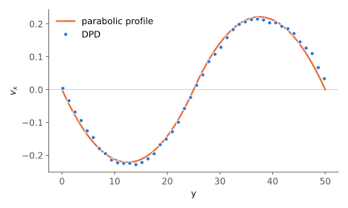
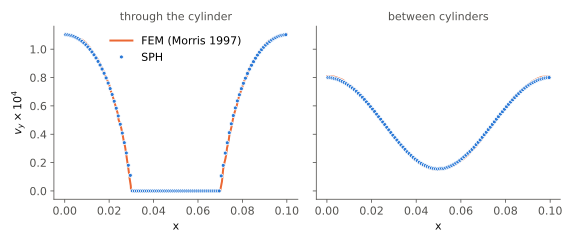
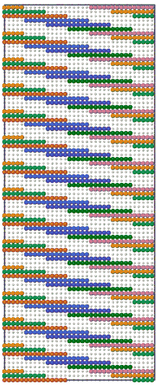
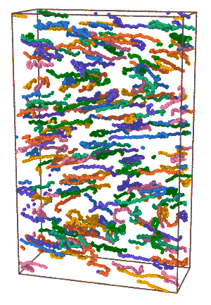

# lammps-configs

LAMMPS input files for dissipative particle dynamics (DPD) and smoothed
particle hydrodynamics (SPH): solvent and polymer solutions in shear,
Poiseuille and reverse Poiseuille flow, flow past cylinders, and
multiphase SPH.

## Contents

`le` in a directory name means Lees-Edwards boundary conditions:
periodic boundaries that slide past each other to impose uniform shear
(`fix deform` with `remap v`).

DPD solvent
- `dpd-solvent`, `dpd-resonance`: bulk solvent, Backer et al. (2005)
- `dpd2d`, `dpd3d`, `dpd2d-wall`, `dpd2d-wall-hres`: reverse and wall-bounded Poiseuille flow
- `dpd-poiseuille`, `dpd-with-wall`: Poiseuille flow, J. Chem. Phys. 132, 144103 (2010)
- `dpd-2d-solvent`: equilibrium, Lees-Edwards, Couette, and reverse Poiseuille flow

DPD polymers
- `dpd-2d-polymer-le`, `dpd-3d-polymer-le`, `dpd2d-le`: polymers under Lees-Edwards shear
- `dpd-2d-polymer-wall`, `dpd2d-wall-polymer`: polymers between moving walls
- `dpd-2d-reverse-polymer`: reverse Poiseuille, wall shear, stretching, relaxation, trap, and flow past a cylinder (`in.generic` selects the case)
- `dpd-polymer-solution`, `dpd-polymer-extension`: chain statistics and FENE extension
- `dpd-old`, `dpd-sultan`, `dpd-with-wall-polymers`: generated chains in channel flow; `dpd-old` pulls chain ends apart with `bond_style stretching`

SPH
- `lammps-sph-flow-around-cylinder`: flow past a periodic array of cylinders, Morris et al. (1997)
- `falling-block`, `lock-exchange-flow`: solid block and two-fluid setups
- `mfsph`, `mfsph-flow-around-cylinder`: multiphase SPH

Other
- `step-by-step`: small inputs that test single features
- `bugs`: minimal inputs for LAMMPS issues
- `configs`: per-host `.lammps-configs` (sets `lmp`, `mpirun`)
- `figures`: viscosity data and gnuplot scripts
- `scripts`: chain generation (`mkchain.sh`), polymer insertion (`addpolymer.sh`), post-processing
- `src`: `bond_style stretching`, FENE bond plus a constant force pulling the two atoms apart inside a region

Generalized DPD (weight exponent, separate cutoffs for conservative and
dissipative forces) uses `pair_style hybrid/overlay dpd/ext dpd`.

## Build

LAMMPS 30 Sep 2026:

```
cp src/* lammps/src/
cd lammps/src
make yes-MOLECULE yes-DPD-BASIC yes-DPD-SMOOTH yes-SPH yes-GRAPHICS yes-EXTRA-DUMP
make -j mpi LMP_INC="-DLAMMPS_GZIP -DLAMMPS_JPEG" JPG_LIB=-ljpeg
```

The mfsph inputs also need the multiphase styles from
https://github.com/slitvinov/lammps-sph-multiphase (`MULTIPHASE/*`).

Run scripts use `LMP` and `MPIRUN`, e.g. `LMP=lmp_mpi bash run.sh`.

## Examples

Reverse Poiseuille flow, `dpd-2d-solvent/in.reverse`



SPH flow around a periodic array of cylinders,
`lammps-sph-flow-around-cylinder/in.cylinder`, compared with Morris et
al. (1997)



2D polymer solution under Lees-Edwards shear, `dpd-2d-polymer-le`



3D polymer solution in reverse Poiseuille flow, `dpd-2d-reverse-polymer`


